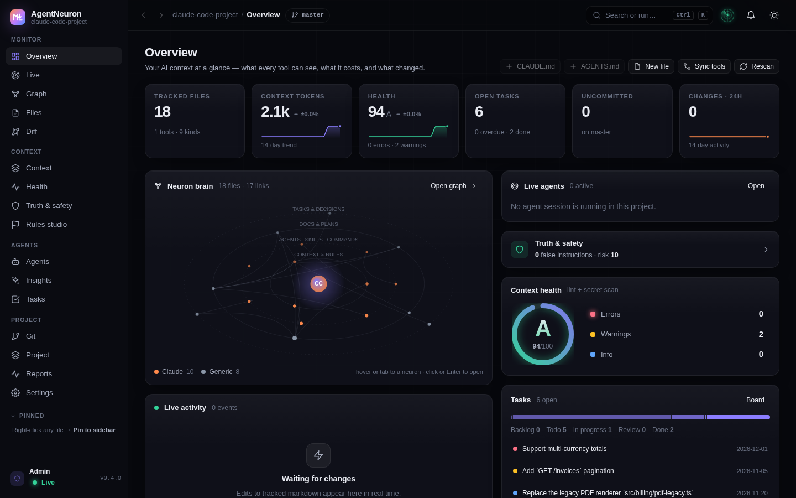

# AgentNeuron

A live control center for the markdown that steers your AI coding tools: `CLAUDE.md`, `AGENTS.md`, Cursor rules, Copilot instructions, skills, subagents, plans and docs.

[](https://www.npmjs.com/package/agentneuron)
[](LICENSE)
[](https://nodejs.org)
[](https://github.com/TurjoAt/agentneuron/actions/workflows/ci.yml)



## Why

AI tools read a growing pile of instruction files, and nobody checks them. Links rot, the same rule is copied into five tools and drifts, a context file quietly grows to 12,000 tokens, someone pastes an API key into `CLAUDE.md`. AgentNeuron scans your project, watches it live, and shows you what each agent will actually see, what is broken, and what changed.

It runs locally, serves its UI from a single file, has no database, and only writes inside `<project>/.agentneuron/`. Everything that changes anything is **off by default**.

## Features

**Monitor**
- Live file watcher with a change feed, per-file version history and diffs.
- Health score (A-F) from lint rules: broken links and `@imports`, missing paths, secrets, oversized context, duplicate rules, stale plans, orphans, empty files.
- Secret scanner; findings never show more than the first 4 characters, and secrets are masked in MCP output, the audit log and notifications.
- Reports: activity series, heatmap, top files (most changed, most linked, stalest, heaviest), CSV/Markdown/HTML export.

**Understand**
- Link graph of files, `@imports`, wiki links and path mentions, with several layouts and path finding.
- Effective context: the merged instruction chain an agent sees for a given directory and tool (Claude, Codex, Cursor), with token counts.
- Agents center: tool matrix, rules that apply to a file, MCP servers, sessions and estimated cost, concurrent-edit radar, context time travel.
- Project intelligence: stacks, dependencies and outdated packages, scripts, CI, Docker, env keys, Laravel routes/models/migrations, doc drift, code stats.
- Tasks from Markdown (`- [ ]`, `- [/]`, `- [x]`, `TODO:`) as board, list, table, calendar and timeline; decision records.
- Git: changes, history, branches, tags, stash, blame, stats, generated changelog.

**Act** (opt-in, see [permission levels](#permission-levels))
- Edit files in the browser, rename with link rewriting, find and replace, soft delete to trash, one-click fixes for lint issues.
- Create files from templates (CLAUDE.md, AGENTS.md, skills, subagents, Cursor rules, ADRs and more).
- Sync instruction files between tools; edit Claude permissions, hooks and `.mcp.json`.
- Git stage/commit/branch, package and script runner, all spawned without a shell, with live job output and an audit log.

**Integrate**
- MCP server (`agentneuron mcp`) so your AI tools can query the same data.
- HTTP + Server-Sent Events API ([docs](docs/http-api.md)).
- `agentneuron lint --json` for CI ([example](examples/ci/)).
- Slack/Discord-compatible webhooks for secrets, conflicts, health drops and job results.
- Workspace mode for a folder of projects.

## Quick start

Requires Node.js 18 or newer.

```sh
npx agentneuron                  # monitor the current directory
npx agentneuron ./my-project     # or any directory
```

Open the printed URL (default `http://127.0.0.1:4747`).

Install globally:

```sh
npm i -g agentneuron
agentneuron ./my-project
```

Per project, as a single file you can commit or hand to a teammate:

```sh
cd my-project
npx agentneuron init                       # creates .agentneuron/config.json and .agentneuron/agentneuron.mjs
node .agentneuron/agentneuron.mjs          # root = parent of .agentneuron, no argument needed
```

No install at all: `dist/agentneuron.mjs` is one self-contained file (UI embedded, no dependencies). Copy it anywhere and run `node agentneuron.mjs /path/to/project`.

Useful variations:

```sh
agentneuron lint                           # print issues, exit 1 on any error (CI friendly)
agentneuron status                         # files, tokens, health in a few lines
agentneuron workspace ~/code               # one UI for a folder of projects
agentneuron mcp                            # MCP server on stdio
agentneuron --enable edit                  # allow editing files from the UI
```

Full walkthrough: [docs/getting-started.md](docs/getting-started.md).

## Supported AI tools

| Tool | Files detected (examples) |
|---|---|
| Claude Code | `CLAUDE.md`, `CLAUDE.local.md`, `.claude/agents/`, `.claude/skills/*/SKILL.md`, `.claude/commands/`, `.claude/rules/`, `.claude/settings*.json`, `.mcp.json` |
| OpenAI Codex | `AGENTS.md`, `AGENTS.override.md`, `.codex/` |
| Cursor | `.cursor/rules/*.mdc`, `.cursorrules`, `.cursor/mcp.json` |
| GitHub Copilot | `.github/copilot-instructions.md`, `.github/instructions/*.instructions.md`, `.github/prompts/`, `.github/chatmodes/` |
| Windsurf | `.windsurfrules`, `.windsurf/rules/`, `.windsurf/workflows/` |
| Gemini CLI | `GEMINI.md`, `.gemini/` |
| Cline, Roo Code, Aider, Continue, Zed, JetBrains Junie, Amazon Q | detected and shown in the Agents matrix; see [supported tools](docs/supported-tools.md) |

Any other Markdown in the project (README, TODO, ROADMAP, ADRs, `docs/`) is tracked too. Add your own patterns with `extraPatterns`.

## Permission levels

AgentNeuron starts read-only. Higher levels must be enabled explicitly in `.agentneuron/config.json` (`"actions"`) or with `--enable`.

| Level | Allows | Enabled by |
|---|---|---|
| `read` | Monitor, search, graph, health, git read | always |
| `state` | AgentNeuron's own data in `.agentneuron/`: task board, bookmarks, annotations, rescan | admin role |
| `edit` | Write project files, git stage/commit/branch, history restore, trash restore | `actions.edit` / `--enable edit` |
| `exec` | Run commands: package managers, scripts, git fetch/pull/push, MCP test; also edit files that make agent tools run commands (Claude hooks and permissions, `.mcp.json`) | `actions.exec` / `--enable exec` |
| `danger` | Discard changes, delete branches, run migrations, clear history, purge trash | `actions.danger` / `--enable danger` |
| `terminal` | Free-form command runner (also requires `danger`) | `actions.terminal` / `--enable terminal` |

## Security

- Binds to `127.0.0.1` by default. A non-loopback `--host` forces a token (auto-generated if you do not set one).
- Two roles: `admin` and read-only `viewer` (`--admin-token` plus `--token`).
- Commands are spawned without a shell; every parameter is validated; file paths cannot leave the project.
- Every state-changing request and every action is written to `.agentneuron/audit.jsonl` with secrets masked.
- Never expose `exec`, `danger` or `terminal` over plain HTTP.

See [docs/security.md](docs/security.md) for the summary and read [docs/permissions-and-security.md](docs/permissions-and-security.md) before binding to anything other than localhost. To report a vulnerability see [SECURITY.md](SECURITY.md).

## Documentation

Start at [docs/README.md](docs/README.md).

| | |
|---|---|
| [Getting started](docs/getting-started.md) | Install, first run, tour of every page |
| [CLI reference](docs/cli.md) | Commands and flags |
| [Configuration](docs/configuration.md) | Every `config.json` key |
| [Permissions and security](docs/permissions-and-security.md) | Levels, roles, tokens, remote access, TLS |
| [HTTP API](docs/http-api.md) | Endpoints, levels, parameters |
| [Actions](docs/actions.md) | Action ids and parameters |
| [MCP](docs/mcp.md) | Use AgentNeuron from Claude Code, Cursor and others |
| [Supported tools](docs/supported-tools.md) | Detected files per tool |
| [Project intelligence](docs/project-intelligence.md) | What is detected about your project |
| [Architecture](docs/architecture.md) | Module map and build |
| [FAQ](docs/faq.md), [Troubleshooting](docs/troubleshooting.md) | |

Runnable [examples](examples/) cover a Claude Code project, a multi-tool project with drift, config variants, a CI workflow and deployment files.

## Develop

```sh
git clone https://github.com/TurjoAt/agentneuron.git
cd agentneuron
npm install
npm test                # node --test
npm run ui:dev          # UI dev server (Vite)
npm run dev             # run the CLI from source
npm run build           # builds the UI and bundles dist/agentneuron.mjs
```

## Contributing

Issues and pull requests are welcome. See [CONTRIBUTING.md](CONTRIBUTING.md) and the [Code of Conduct](CODE_OF_CONDUCT.md). Changes are tracked in [CHANGELOG.md](CHANGELOG.md).

## License

[MIT](LICENSE) (c) Rezaul Hoque Turjo.

## Author

Created and maintained by **Rezaul Hoque Turjo** - [turjo.me](https://turjo.me) - [hi@turjo.me](mailto:hi@turjo.me)
